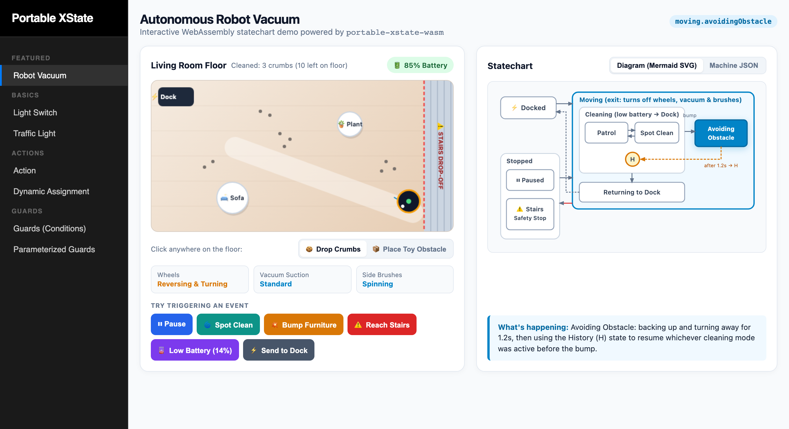

# Lavi

**Lavi** is a portable, low-memory statechart and actor runtime compatible with **XState v5**, written in `#![no_std]` Rust (`lavi`) with idiomatic bindings for **WebAssembly / JavaScript / TypeScript** (`lavi-wasm`), **C / C++ on embedded microcontrollers** (`lavi-c-cpp` / PlatformIO), **Python** (`lavi-py`), and **Java / Kotlin / Android** (`lavi-jvm`).

## Why Lavi?

### Design in XState. Run Everywhere.
XState v5 and Stately Studio provide an expressive, standardized JSON configuration format for Harel Statecharts and W3C SCXML semantics. **Lavi** brings that same statechart execution model beyond JavaScript so the exact same machine definition can run identically across:
- **Embedded Microcontrollers (C / C++ / PlatformIO)**: Run statecharts on ESP32, STM32, or bare-metal targets with `#![no_std]` safety and a bounded $O(1)$ CPU call stack.
- **Native Systems (Rust)**: Embed a lightweight `#![no_std]` + `alloc` statechart engine (`indexmap` is the sole dependency; zero `serde` overhead).
- **Browsers & Node.js (WebAssembly)**: Use XState v5's `createMachine`, `createActor`, `setup`, `assign`, and `SimulatedClock` APIs backed by the compiled WASM core.
- **Backend Services & Simulation (Python)**: Run statecharts in Python services or drive deterministic tests in `pytest` with `SimulatedClock` using `lavi-py`.
- **Server JVM & Android (Java & Kotlin)**: Embed statecharts in server backends or Android mobile apps with zero-friction native loading (`.jar`) and 16 KB page-aligned AAR packaging (`.aar`) using `lavi-jvm`.

### Why the Name "Lavi"?
Statecharts were invented in 1983–1987 by computer scientist **David Harel** in collaboration with systems engineering pioneer **Dr. Jonah Z. Lavi** while designing the avionics software for the **Lavi** aircraft—where complex embedded flight-control logic needed a deterministic, hierarchical state model. *Lavi* (לָבִיא) also means "young lion" in Hebrew.

## Core Principles

1. **Strict XState 5 Behavioral Conformance**: Validated directly against upstream `statelyai/xstate` (`v5.25.0`) conformance tests with automated provenance verification (`npm run test:conformance-check`).
2. **Microcontroller-Ready Resource Envelope**:
   - `#![no_std]` + `alloc` core (`indexmap` is the sole dependency in `lavi`; zero `serde` overhead).
   - Bounded $O(1)$ CPU call-stack parsing and traversal via explicit heap work-stacks (`Vec`), fitting comfortably inside an 8 KB ESP32 FreeRTOS `loopTask` stack.
   - Zero-copy `const char*` JSON configuration in C/C++ and bounded runtime memory (pre-start events are safely dropped rather than queued on the heap).
3. **Idiomatic Target-Language APIs**:
   - **JS / TS (WASM)**: `createMachine`, `createActor`, `setup`, `assign`, and `SimulatedClock`.
   - **C (`lavi.h`)**: Opaque handles (`MachineContext*`, `SimulatedClock*`, `const fsm_value_t*`) and function pointers with `void* user_data`.
   - **C++11 (`lavi.hpp`)**: Move-safe RAII classes (`lavi::Machine`, `lavi::SimulatedClock`, `lavi::Value`) supporting both zero-allocation function pointers and `std::function` lambdas.
   - **Rust (`lavi`)**: Strongly-typed `#![no_std]` `RuntimeMachine`, `MachineDefinition`, and `SimulatedClock`.
   - **Python (`lavi-py`)**: Idiomatic `Machine`, `SimulatedClock`, `Value`, decorators (`@machine.action`, `@machine.guard`), context managers (`with Machine(...)`), and dict/list payload interop.
   - **Java (`lavi-jvm`)**: `AutoCloseable` `Machine` and `SimulatedClock`, fluent registration (`registerAction`, `registerGuard`), and zero-GC-leak callback mechanics.
   - **Kotlin (`lavi-jvm`)**: Trailing lambdas (`onAction`, `onGuard`, `onClock`), operator indexing (`ctx["key"]`), and `Map<String, Any?>` event payload support.

## Interactive WASM Demos

Hierarchical statecharts replace fragile `if/else` boolean-flag logic with declarative guarantees—such as parent-state `exit` safety cutoffs, eventless `always` guards, `after` timers, and `history` recovery—that run identically in the browser (WASM) and on microcontrollers (Rust / C / C++).

👉 **[Explore the Live Interactive WASM Examples →](https://emmby.github.io/lavi/examples/)**

<a href="https://emmby.github.io/lavi/examples/">
  
</a>

## Project Structure

* **`lavi`**: Pure `#![no_std]` + `alloc` Rust statechart engine, iterative JSON parser (`src/json.rs`), and move-based machine builder (`src/parser.rs`).
* **`lavi-wasm`**: WebAssembly adapter exposing XState 5's JavaScript/TypeScript API and bridging inline JS callbacks to named runtime handlers.
* **`lavi-c-cpp`**: C/C++ static library and headers (`include/lavi.h`, `include/lavi.hpp`) for embedded (`espressif32`) and host (`native`) targets.
* **`lavi-py`**: Python native extension via PyO3 (`abi3-py38`) with full `.pyi` type stubs and pytest integration.
* **`lavi-jvm`**: Java and Kotlin JNI bridge via `jni-rs` with Gradle `java-library`, desktop resource extraction, and Android AAR packaging.
* **`scripts/build-release-natives.mjs`**: Single-host cross-compilation plan generator and Android AAR packager (16 KB page-alignment check).
* **`library.json` / `build_rust.py`**: Root PlatformIO library manifest and Cargo build hook (`lib_deps = https://github.com/emmby/lavi.git`).
* **`tests/` & `tests/upstream/`**: XState 5 conformance test suite and pinned upstream reference fixtures verified by `scripts/check-conformance-tests.mjs`.
* **`AGENTS.md` / `PROCESS.md` / `TECH_DEBT.md`**: Agent engineering guidelines, autonomous swarming workflow, and legacy cleanup queue.

## Building & Testing

### Build All Targets
```bash
npm run build
```

### Run All Tests
Runs the conformance provenance check, native Rust unit tests, headless Chrome WASM tests, Playwright E2E tests, C/C++ static library + PlatformIO build script tests, Python pytest tests, Java & Kotlin JUnit tests, and Vitest XState 5 conformance tests:
```bash
npm test
```

Or run individual suites:
- `npm run test:conformance-check` (Upstream XState 5 test provenance check)
- `npm run test:native` (Rust `#![no_std]` core tests)
- `npm run test:wasm` (WASM browser tests)
- `npm run test:e2e` (HTML examples via Playwright)
- `npm run test:c-cpp` (C, C++, and PlatformIO `build_rust.py` tests)
- `npm run test:py` (Python unit tests via pytest)
- `npm run test:jvm` (Java and Kotlin unit tests via Gradle JUnit 5)
- `npm run test:unit` (XState 5 conformance suite via Vitest)

## Usage Examples

### JavaScript / TypeScript (WASM)
```javascript
// TODO(flowos: e9505536-8f94-4c57-8de4-944e1257ce7c): Publish `lavi-wasm` to npm
import { createMachine, createActor, assign } from 'lavi-wasm';
// (Or import from './lavi-wasm/pkg-npm/lavi.js' when running from a local repo build)

const machine = createMachine({
  initial: 'idle',
  context: { count: 0 },
  states: {
    idle: {
      on: {
        START: {
          target: 'running',
          actions: assign({ count: ({ context }) => context.count + 1 })
        }
      }
    },
    running: {
      on: { STOP: 'idle' }
    }
  }
});

const actor = createActor(machine).start();
console.log(actor.getSnapshot().value); // "idle"

actor.send({ type: 'START' });
console.log(actor.getSnapshot().value); // "running"
console.log(actor.getSnapshot().context.count); // 1
```

### C++11 (ESP32 / PlatformIO / Native)
```cpp
#include "lavi.hpp"

const char* MACHINE_JSON = R"({
  "initial": "idle",
  "states": {
    "idle": { "on": { "START": { "target": "running", "actions": ["onStart"] } } },
    "running": { "after": { "1000": "idle" } }
  }
})";

lavi::Machine fsm(MACHINE_JSON);
fsm.registerAction("onStart", [](const lavi::Value& ctx, const lavi::Value& evt) {
  // Handle action
});
fsm.registerClock(millis); // Or bind a lavi::SimulatedClock for deterministic tests
fsm.start();

fsm.send("START");
bool is_running = fsm.matches("running"); // true
fsm.tick();
```

### Python (`lavi-py`)
```python
from lavi import Machine, SimulatedClock, Value

MACHINE_JSON = """{
  "initial": "idle",
  "states": {
    "idle": { "on": { "START": { "target": "running", "actions": ["onStart"] } } },
    "running": { "after": { "1000": "idle" } }
  }
}"""

clock = SimulatedClock(initial_ms=0)
with Machine(MACHINE_JSON, clock=clock) as machine:
    @machine.action("onStart")
    def handle_start(ctx: Value, evt: Value) -> None:
        print("Started with count:", ctx.get("count", 0))

    machine.start()
    machine.send("START", payload={"boost": 10})
    assert machine.matches("running")
    clock.increment(1000)
    assert machine.matches("idle")
```

### Java (`lavi-jvm`)
```java
import io.lavi.Machine;
import io.lavi.SimulatedClock;

String json = """
  {
    "initial": "idle",
    "states": {
      "idle": { "on": { "START": { "target": "running", "actions": ["onStart"] } } },
      "running": { "after": { "1000": "idle" } }
    }
  }
""";

try (SimulatedClock clock = new SimulatedClock(0);
     Machine machine = new Machine(json, clock)
         .registerAction("onStart", (ctx, evt) -> {
             long boost = evt.getProperty("boost").asLong().orElse(0L);
         })) {
    machine.start();
    machine.send("START", "{\"boost\": 10}");
    assert machine.matches("running");
    clock.increment(1000);
    assert machine.matches("idle");
}
```

### Kotlin (`lavi-jvm`)
```kotlin
import io.lavi.Machine
import io.lavi.SimulatedClock
import io.lavi.*

SimulatedClock(0).use { clock ->
    Machine(json, clock).use { machine ->
        machine.onAction("onStart") { ctx, evt ->
            val boost = evt["boost"].asLongOrNull() ?: 0L
        }
        machine.start()
        machine.send("START", mapOf("boost" to 10))
        assert(machine.matches("running"))
        clock.increment(1000)
        assert(machine.matches("idle"))
    }
}
```

## Known Discrepancy: XState 5 Parity vs. Microcontroller Memory Safety

To safely target severely memory-constrained embedded environments (such as ESP32 and Arduino microcontrollers), `lavi` intentionally deviates from XState 5 on pre-initialization event buffering:

- **In XState 5 (JS)**: Calling `actor.send()` before `actor.start()` appends events to a dynamically growing heap array (mailbox buffer) flushed on `start()`.
- **In `lavi`**: Calling `send()` before `start()` safely **drops** the event, preventing unbound hardware interrupts or rapid sensor polling before boot from exhausting heap memory.

## For Contributors: Agentic Development & Parallel Swarming

In any new conversation on this repository, [`AGENTS.md`](./AGENTS.md) is automatically loaded into the agent's system prompt, enforcing the [`PROCESS.md`](./PROCESS.md) cross-target workflow (`Rust` $\rightarrow$ `WASM` $\rightarrow$ `C/C++`) and automated conformance provenance checks (`npm run test:conformance-check`).

You can launch agents in three ways:

### 1. Use `/teamwork` (or ask for a parallel subagent swarm in one conversation)
Start a new conversation and either type **`/teamwork`** or prompt:
> *"Pick 3 orthogonal tasks from `XSTATE_5_FEATURES.md` / `TECH_DEBT.md` and spawn 3 parallel subagents in isolated branches (`Workspace: "branch"`) following `PROCESS.md`, then audit and merge their branches."*

The main agent acts as the coordinator, spawns `self` subagents with `Workspace: "branch"` (each in its own git worktree), waits for them to finish, audits their diffs against `AGENTS.md`, and merges them cleanly.

### 2. Ask for a specific set of features or tech-debt items
If you already know which conformance suites or `TD-N` cleanup items you want implemented:
> *"Spawn 2 parallel branch subagents following `PROCESS.md`:*
> *1. Resolve `TD-1` (`after.test.ts` full upstream restoration) from `TECH_DEBT.md`.*
> *2. Onboard `guards.test.ts` across Rust, WASM, and C/C++ under strict provenance."*

### 3. Separate top-level conversations in Antigravity (Worktree mode)
If you prefer separate top-level chat threads instead of subagents:
- Open a new conversation in the Agent Manager with **Worktree isolation** enabled.
- Give it a single one-liner:
  > *"Follow `PROCESS.md` to onboard `final.test.ts` across Rust, WASM, and C/C++."* or *"Resolve `TD-6` from `TECH_DEBT.md`."*

## License & Attribution

- **Lavi Runtime (`lavi`, `lavi-wasm`, `lavi-c-cpp`)**: Licensed under the [MIT License](./LICENSE) (`Copyright (c) 2025-2026 Mike Burton`).
- **Conformance Test Suite (`tests/` & `tests/upstream/`)**: Adapted from the [statelyai/xstate](https://github.com/statelyai/xstate) repository (`xstate@5.25.0`), `Copyright (c) 2015 David Khourshid`, used under the MIT License. See [`tests/LICENSE-THIRD-PARTY`](./tests/LICENSE-THIRD-PARTY) for the full notice.
- **Standards & Prior Art**: Statechart execution semantics follow David Harel's Statecharts formalism (1987) and the [W3C SCXML Specification](https://www.w3.org/TR/scxml/).
- **Acknowledgments & Non-Affiliation**: With thanks to David Khourshid and the Stately.ai team for their work on XState and Stately Studio. Lavi is an independent community project and is not affiliated with, officially maintained by, or endorsed by Stately.ai or David Khourshid.
